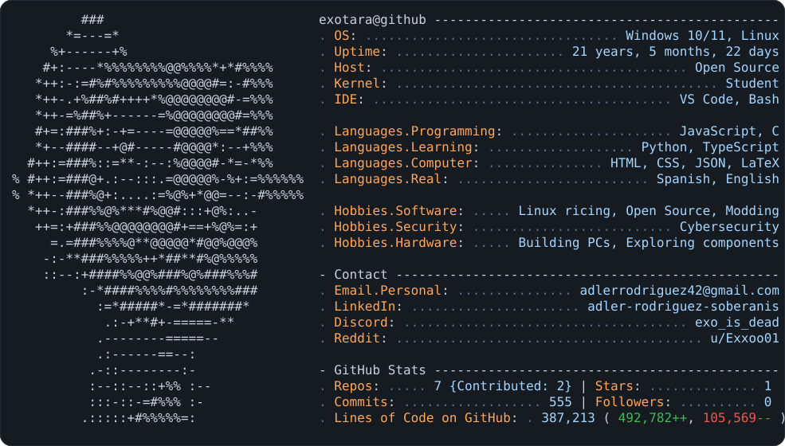

<picture>
  <source media="(prefers-color-scheme: dark)" srcset="dark_mode.svg">
  <source media="(prefers-color-scheme: light)" srcset="light_mode.svg">
  
</picture>

Hi, I'm Adler 👋 Learning to code, one config file at a time.
 
Hola, soy Adler. Aprendiendo a programar :b
